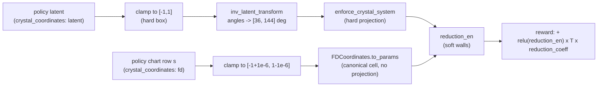

# Cell fundamental domains

*Drift: **T** (theory). Verified against commit `dac8069b` (mxtaltools `b6155c4a`), 2026-11-13. Sources at the end.*

A crystal's unit cell is not uniquely determined by the crystal. Any integer change of lattice basis $\mathbf{a}' = M\mathbf{a}$ with $\det M = \pm 1$ describes the same lattice, and a subset of those changes also leaves the space group's symmetry operators in the form the code stores them (`constants/space_group_info.py::SYM_OPS`, one fixed operator list per space-group number). That subset is a group, the *setting group* of that space group, acting on the six cell parameters $(a,b,c,\alpha,\beta,\gamma)$. A *fundamental domain* is a region of parameter space containing exactly one point of each orbit. Without one, the same crystal is reachable at infinitely many parameter points, so the target carries a multiplicity that varies from lattice to lattice.

This page is about the cell only: the domain per setting class, the walls the code evaluates, which mechanism holds the cell in its domain on each route to the reward, and how the walls enter the reward. The route is chosen by `cfg:energy_config.crystal_coordinates`. With `latent` the sampler's coordinates are the trainer latent, and the cell is constrained by a clamp, a projection and soft walls. With `fd` the coordinates are the `crystal_fd` chart (`energies/fd_coordinates.py::FDCoordinates`, Z' = 1), every point of which is a canonical cell inside a length box: in the triclinic and monoclinic domains below, and from orthorhombic up at the group's exact metric, in orthorhombic groups in the axis order `crystal_fd/axis_order.py::choose` picks. Two other redundancies act on the crystal and are different objects with different pages. The *pose* of the asymmetric unit, its centroid and orientation, is redundant under the Euclidean normaliser of the space group, a discrete quotient $N_E(G)/G$ plus a continuous translation along any direction every rotation part of $G$ fixes; that is [asymmetric-unit-reduction](asymmetric-unit-reduction.md). Which latent rows are held out of the diffusion because a projection overwrites them is [latent-dimension-structure](latent-dimension-structure.md). Also left out: the cluster reach used when a periodic neighbour list is built, and the setting-and-origin handling of `compute_standard_cell`; only which cell that function returns, in which convention, matters here.

## The setting group is per space group, not per crystal system

A basis change is admissible only if every stored operator survives it, up to an origin shift.

- **Triclinic (sg 1, 2).** The operator list is $\{E\}$ or $\{E,\bar{1}\}$, invariant under everything, so the setting group is all of $GL(3,\mathbb{Z})$ and the domain is the Niggli cell.
- **Monoclinic (sg 3 to 15), $b$-unique, cell choice 1.** Only the $ac$ plane moves: $\mathbf{a}' = p\mathbf{a}+q\mathbf{c}$, $\mathbf{c}' = r\mathbf{a}+s\mathbf{c}$, $ps-qr=\pm1$, $\mathbf{b}' = \det \cdot \mathbf{b}$. Which of those keep the operator list is a condition on one entry, splitting sg 3 to 15 into the three classes of `common/sym_utils.py::MONO_CLASS`: `MONO_GLIDE` (7, 13, 14; $r$ even), `MONO_CENTRED` (5, 8, 9, 12, 15; $q$ even), `MONO_FREE` (3, 4, 6, 10, 11; any change).
- **Orthorhombic and above.** The metric constraints already pin the shape. In orthorhombic groups the residual redundancy of the six cell parameters is a finite group of axis permutations: all six orders in 11 groups, $a\!\leftrightarrow\!b$ with $c$ fixed in 26, the three cyclic orders in Pbca, none in the other 21 (`crystal_fd/axis_order.py::axis_orders` derives these from the operator tables at first use and raises `RuntimeError` if the counts differ from `crystal_fd/axis_order.py::SURVEY_COUNTS`). Sign flips leave orthogonal cell parameters unchanged. From tetragonal up, every setting-preserving basis change preserves the metric, so it moves only the pose ([asymmetric-unit-reduction](asymmetric-unit-reduction.md)), and the cell carries no setting redundancy.

## Triclinic: the Niggli conditions, in a shifted sign convention

Write $A=a^2$, $B=b^2$, $\xi = 2\,\mathbf{b}\!\cdot\!\mathbf{c}$, $\eta = 2\,\mathbf{a}\!\cdot\!\mathbf{c}$, $\zeta = 2\,\mathbf{a}\!\cdot\!\mathbf{b}$. The Niggli main conditions are

$$a \le b \le c, \qquad |\xi| \le B, \quad |\eta| \le A, \quad |\zeta| \le A, \qquad |\mathbf{a}+\mathbf{b}+\mathbf{c}| \ge c,$$

plus a sign condition: $\xi,\eta,\zeta$ all positive (type I, all-acute) or all non-positive (type II). With boundary tie-breaks these select one cell per lattice.

`sym_utils.py::tri_niggli_reduction_penalty` evaluates the order, pairwise, sign and three-vector conditions as squared hinges: each condition $g \le 0$ contributes $\mathrm{relu}(g)^2$, so the penalty is zero exactly on the closed domain and rises quadratically outside it. The boundary tie-breaks are omitted, so uniqueness holds up to measure-zero ties. Its sign wall differs from Niggli's: it takes $\eta \le 0$, $\zeta \le 0$, $\xi$ free: $\beta$ and $\gamma$ obtuse, $\alpha$ unconstrained. The zero set selects one cell per lattice and is one connected region, in which $\alpha$ crosses $90^\circ$ without the cell jumping. The two rules agree on all-obtuse cells; an all-acute Niggli cell maps into this one by $(\mathbf{a},-\mathbf{b},-\mathbf{c})$, which fixes $\alpha$, sends $\beta \to 180^\circ-\beta$ and $\gamma \to 180^\circ-\gamma$, and preserves handedness and the P1/P$\bar{1}$ operators. So an all-acute cell from an external reducer, whether `crystal_ops.py::MolCrystalOps.compute_standard_cell`, `common/ase_interface.py::get_niggli_cell`, spglib or ASE, scores a positive penalty until that flip is applied. `crystal_fd/ops.py::reduce_cell` returns triclinic cells in this convention directly: its basis search (`crystal_fd/ops.py::triclinic_basis`) keeps the candidates that satisfy `crystal_fd/ops.py::tri_niggli_conditions`, which are the penalty's walls at margin 0, within `tol`, and breaks ties by the lexicographically smallest $(A,B,C,\xi,\eta,\zeta)/\mathrm{mean}(A,B,C)$.

The S-sign walls, `sym_utils.py::legacy_tri_reduction_penalty`, are reachable only through `MXT_LEGACY_TRICLINIC_WALLS=1`: ordering and pairwise $|\cos|$ bounds plus $\mathrm{relu}(S)^2$ with $S = ab\cos\gamma + ac\cos\beta + bc\cos\alpha$ (`sym_utils.py::niggli_reduction_penalty`), which is neither sign branch and rejects every all-acute cell. The variable is read at import: unset reads as `'0'`, a value other than `'0'` or `'1'` raises `ValueError`, and `'1'` prints a warning to stderr and emits a `UserWarning`. `MXT_NIGGLI_TRICLINIC` is retired: setting it, to any value, raises `RuntimeError` at import.

## Monoclinic: a three-wall domain from $\Gamma_0(2)$

With $\tau = (a/c)\,e^{i\beta}$ in the upper half plane, the glide-class basis changes act as modular transformations: $\mathbf{a}\to\mathbf{a}+n\mathbf{c}$ is $\tau \to \tau+n$, $\mathbf{c}\to\mathbf{c}+2m\mathbf{a}$ is $\tau \to \tau/(2m\tau+1)$, the $\beta$ twin is $\tau \to -\bar\tau$. The group is $\Gamma_0(2)$, whose domain $-\tfrac12 \le \operatorname{Re}\tau \le 0$, $|\tau + \tfrac12| \ge \tfrac12$ reads as three walls:

$$\text{W1: } \cos\beta \le 0, \qquad \text{W2: } c\,|\cos\beta| \le a, \qquad \text{W3: } a\,|\cos\beta| \le c/2 .$$

`sym_utils.py::mono_reduction_penalty` implements all three as one two-sided bound on $\cos\beta$, per class: the limit is $\min(a/c,\ c/2a)$ for `MONO_GLIDE`, $\min(c/a,\ a/2c)$ for `MONO_CENTRED` (the $a\!\leftrightarrow\!c$ mirror image: keeping the $C$-centring requires $q$ even, and in Cc and C2/c the centring makes the $c$- and $n$-glides coexist, so the glide puts no condition on $r$), and $a/2c$ for `MONO_FREE`, which instead gets an explicit ordering hinge $a \le c$, since its setting group contains the swap. In the zero set (from the limits above) $\beta$ reaches at most $135^\circ$ for `MONO_GLIDE` and `MONO_CENTRED` and $120^\circ$ for `MONO_FREE`. The `MONO_FREE` ordering term $\mathrm{relu}(a/c-1)^2$ is unbounded above, unlike every other term here. The penalty also carries the pins $(\alpha-\pi/2)^2$ and $(\gamma-\pi/2)^2$. Applying one class's walls to another is a different domain, and can leave lattices with no zero-penalty cell at all.

## Higher systems: metric only in the walls

For orthorhombic, tetragonal, trigonal, hexagonal and cubic, the `sym_utils.py` functions contribute only crystal-system terms, squared differences driving $\alpha,\beta,\gamma$ to $\pi/2$ or $2\pi/3$ and the constrained lengths to each other, and no reduction term; the length-ordering hinges are present but commented out in `sym_utils.py::ortho_reduction_penalty` and `::tetra_reduction_penalty`. `sym_utils.py::cell_reduction_penalty` scores sg 16 to 74 with `::ortho_reduction_penalty`, 75 to 142 with `::tetra_reduction_penalty`, 143 to 167 with `::trig_reduction_penalty`, in hexagonal axes, 168 to 194 with `::hex_reduction_penalty` and 195 to 230 with `::cube_reduction_penalty`; it does not call `::rhombo_reduction_penalty`. The setting-group argument above gives orthorhombic groups a residual finite redundancy of axis permutations, and therefore a fundamental domain; from tetragonal up the standard cell is already unique. The walls select no unique cell outside triclinic and monoclinic. `crystal_fd` does: `crystal_fd/axis_order.py::choose` picks, among the group's allowed axis orders, the one whose $(\log a, \log b, \log c)$ is lexicographically smallest within a tolerance ($a \le b \le c$ where all six orders are allowed, $a \le b$ where $a\!\leftrightarrow\!b$ is, the shortest axis first in Pbca), and `crystal_fd/canon.py::canonicalize` applies it to sg 16 to 74 after snapping each cell to its group's exact metric. On the `fd` route the trainer's coordinate is the `crystal_fd` chart, whose orthorhombic cell block (`crystal_fd/charts.py::CellChart`) is the canonical domain of `::choose`; on the `latent` route nothing selects among the orthorhombic axis orders.

## Hard projection, hard box, soft walls

The cell reaches the reward along one of two routes. On the `latent` route three mechanisms constrain it. On the `fd` route the chart is the domain, and the walls are evaluated on cells already in their zero set.

`crystal_ops.py::MolCrystalOps.latent_to_cell_params` clamps every latent entry to $[-1,1]$ (the three length rows to a floor of $-0.99$, the $a$ and $b$ rows to a ceiling of $1-10^{-4}$) before `::MolCrystalOps.inv_latent_transform`, which applies no clamp of its own, maps the angle rows linearly onto $[0.2\pi, 0.8\pi]$, i.e. $[36^\circ, 144^\circ]$. That hard bound is what truncates the unbounded shear orbit of a monoclinic cell when W3 is absent. `geometry_utils.py::enforce_crystal_system` then *overwrites* the constrained angles with exact constants, a hard projection, so the crystal-system terms in the penalty are structurally zero on this path. `crystal_analysis.py::MolCrystalAnalysis.compute_cell_reduction_penalty` defaults to `margin=0.0`, the closed domain, and the training path passes no margin on either route; `sym_utils.py::cell_reduction_penalty` itself defaults to `margin=0.1`, which shrinks the zero set and can leave a lattice with no zero-penalty cell.

`crystal_ops.py::MolCrystalOps.latent_to_cell_params` takes an optional `widen_to`, which widens the clamp bounds per row and entry to include the values passed. `crystal_ops.py::MolCrystalOps.log_noise_latent_parameters` passes its unclipped starting latents there under `keep_start_representable=True` and then calls `crystal_ops.py::MolCrystalOps.clean_cell_parameters`, whose angle bound at its default `angle_pad=0.6` is the same $[0.2\pi, 0.8\pi]$ and is not widened. The training path passes no `widen_to`.

On the `fd` route, `energies/molecular_crystal.py::MolecularCrystal.instantiate_crystals` does not call `latent_to_cell_params`, and no `enforce_crystal_system` step runs. The state is laid out in the slots of `energies/fd_coordinates.py::FDSlotLayout` over `cfg:space_groups`, with the slots a group leaves empty held at 0; `MolecularCrystal.__init__` raises `NotImplementedError` unless every Z' is 1. `energies/molecular_crystal.py::MolecularCrystal.fd_rows_to_params` clamps each chart row into $[-1+\epsilon, 1-\epsilon]$, $\epsilon$ = `energies/molecular_crystal.py::FD_OPEN_EPS` ($10^{-6}$), and maps it through `energies/fd_coordinates.py::FDCoordinates.to_params`, the `crystal_fd` chart of the row's space group in the length box `energies/fd_coordinates.py::length_box` (every cell length in $[2.5,\ 2Z(r+3)]$ Angstrom, $Z$ the length of `SYM_OPS[sg]`, $r$ the molecule radius); `crystal_ops.py::MolCrystalOps.set_cell_parameters` then sets the result with no cleaning and no crystal-system projection. Within the length box, the image of the chart's cell block, `crystal_fd/charts.py::CellChart`, is:

- **Triclinic (sg 1, 2):** the margin-0 zero set of `sym_utils.py::tri_niggli_reduction_penalty`.
- **Monoclinic (sg 3 to 15):** the margin-0 zero set of `::mono_reduction_penalty` for the group's `MONO_CLASS` class: $\alpha=\gamma=\pi/2$, $\cos\beta = -s\,m(a,c)$ with $s \in [0,1]$ and $m$ the class limit of `crystal_fd/ops.py::mono_bound`, and $a \le c$ carried by the length bounds for `MONO_FREE`.
- **Orthorhombic and up:** one coordinate per free log length with the angles fixed at the exact metric, cut in sg 16 to 74 by the faces of the axis-order domain of `crystal_fd/axis_order.py::choose`.

The angles are bounded only by the chart; the $[36^\circ, 144^\circ]$ map belongs to the `latent` route.

Stored rows reach the chart by canonicalisation: `energies/fd_coordinates.py::FDCoordinates.from_params` runs `crystal_fd/canon.py::canonicalize` (sheet $+1$; its cell step is `crystal_fd/ops.py::reduce_cell` for sg 1 to 15, and for sg 16 to 230 the snap to the group's exact metric, with `axis_order.choose` in sg 16 to 74), then the chart inverse. A row that does not canonicalise, or whose canonical cell lies outside the length box, has no chart point: `energies/molecular_crystal.py::MolecularCrystal.fd_rows_of` raises `ValueError` on it, and `noised_prior.py::fd_chart_points` returns it as not ok. A crystal built from a policy row carries the clamped row as `fd_state`, which `train.py::Modeller._batch_latents` reads back in place of canonicalising again.

`reduction_en` is still computed on the `fd` route (`MolecularCrystal.computes` holds `'reduction_en'` on both routes) and enters the reward as below. Under the default triclinic walls it is zero up to rounding there: `tests/crystal/test_fd_energy_option.py::test_fd_rows_score_the_same_crystals_as_the_latent_route` checks the reduction energy is below $10^{-3}$, and in MXtalTools `tests/fd/test_gate8_latent.py::test_cell_chart_image_is_the_zero_set_in_the_length_box` (sg 1, 2) and `tests/fd/test_monoclinic_cell.py::test_chart_image_is_the_zero_set_in_the_length_box` check the chart image against `cell_reduction_penalty` at margin 0. The chart's triclinic block is not the zero set of `::legacy_tri_reduction_penalty`, so under `MXT_LEGACY_TRICLINIC_WALLS=1` the term can be positive on chart cells.

The walls reach the sampler only as an energy term. In `energies/molecular_crystal.py::MolecularCrystal.generator_energy` the stored `reduction_en` enters as $\mathrm{relu}(\text{reduction\_en}) \times T \times$ `cfg:energy_config.reduction_coeff`; divided by $T$ in the Boltzmann exponent, the term is $\mathrm{relu}(\text{reduction\_en}) \times$ `reduction_coeff`, independent of $T$. For a latent-scored energy (an analytic function of the latent rather than of a built crystal) the term is zero. The term is summed into the physical leg of the energy with the bounding term, which is computed on both routes from the row the policy emitted, before any clamp, and with the change-of-measure term: `MolecularCrystal.compute_jacobian` on the `latent` route, $-T$ times the chart's log reference density (`fd_log_reference`, from `FDCoordinates.to_params`) on the `fd` route. The energy clips (`cfg:energy_config.reward_range`, armed through `energies/molecular_crystal.py::MolecularCrystal.set_reward_clip`, and `cfg:energy_config.physical_energy_clip`) and the prior-flow mix (`cfg:energy_config.lambda_mix`) act on that physical leg as [reward-construction](reward-construction.md) describes. Under `cfg:energy_config.physical_energy_clip` only the crystal energy is compressed, and this term is added uncompressed.

Softness has an arithmetic consequence: a cell just outside a wall keeps weight $\exp(-c\,\delta)$ rather than none, so the effective copy count per lattice, $K_{\text{eff}} = \sum_{\text{copies}} \exp(-c\,\text{penalty})$, is not an integer near any wall even when the zero set holds exactly one cell.

Off the training path the same penalty is used hard: `crystal_ops.py::MolCrystalOps.sample_random_reduced_crystal_parameters` rejection-samples each row, keeping its first candidate whose penalty at margin 0 is exactly zero, and raises `RuntimeError` for a row with none after `max_rounds` rounds. Under `enforce_reduced`, the crystal-search optimiser `crystal_opt_utils.py::gradient_descent_optimization` evaluates `reduction_en` at `margin=0.01` on every step, `crystal_opt_utils.py::compute_auxiliary_loss` adds $10^4 \times \mathrm{relu}(\text{reduction\_en})$ to the loss, and the returned samples are each trajectory's lowest-loss recorded step, kept only where its penalty at `margin=0.0` is below $10^{-3}$. With `fd_refold`, the same optimiser re-describes a row whose cleaned cell angle comes within `crystal_search/fd_refold.py::REFOLD_ANGLE_MARGIN` of the $[0.2\pi, 0.8\pi]$ clamp, or whose volume factor falls to `crystal_search/fd_refold.py::REFOLD_MIN_VOLUME_FACTOR` or below, as the same crystal in its `crystal_fd` canonical form (`crystal_search/fd_refold.py::refold_triggers`). `crystal_search/standardize.py::standardize_cells` re-expresses a stored crystal in the cell whose `margin=0.0` penalty is zero (at most `crystal_search/standardize.py::PENALTY_ZERO`), by a basis change within the setting group, for crystals whose operator list is `SYM_OPS[sg]`; outside triclinic and monoclinic it changes no cell, and a cell there not already at zero penalty is reported as not handled (`ValueError` under the default `on_failure='raise'`).

## Where the derivation and the code differ

- The design note `docs/design/fundamental_domain.md` states no cell walls and derives no cell domain; the code's triclinic and monoclinic walls are the ones the wall functions and their docstrings in `sym_utils.py` state.
- The note says all three triclinic angle latents reach the penalty and the monoclinic $(\alpha-\pi/2)^2$ pin cannot fire because the projection runs first; the code does both on the `latent` training route, with the pin terms in the penalty live only where the projection is skipped.
- The note says the pin is live in the crystal-search optimiser, which it describes as skipping the projection; in the code each step of `crystal_opt_utils.py::gradient_descent_optimization` calls `crystal_ops.py::MolCrystalOps.clean_cell_parameters`, which applies `geometry_utils.py::enforce_crystal_system` before the penalty is evaluated.
- The setting-group derivation gives the orthorhombic groups a fundamental domain of axis orders; the code's reduction walls do not enforce it, and on the `fd` route the cell block of `crystal_fd/charts.py::CellChart` takes it as its bounds.
- The note does not mention `crystal_fd` or the FD chart; the code's `fd` route builds every cell through that chart.

The note also treats the pose redundancy under the normaliser, and records the flat latent dimensions as unimplemented; the current code state for each is described on [asymmetric-unit-reduction](asymmetric-unit-reduction.md) and [latent-dimension-structure](latent-dimension-structure.md).

## Owner choices

*Left for the owner. Three buckets: bullets bitten, design choices, priorities.*

## Config keys

`cfg:energy_config.crystal_coordinates`, `cfg:energy_config.reduction_coeff`, `cfg:energy_config.temperature`, `cfg:energy_config.reward_range`, `cfg:energy_config.physical_energy_clip`, `cfg:energy_config.lambda_mix`, `cfg:space_groups`, `cfg:z_primes`.

Environment variables: `MXT_LEGACY_TRICLINIC_WALLS` (`'0'` or `'1'`, unset reads as `'0'`; other values raise), `MXT_NIGGLI_TRICLINIC` (retired; raises at import if set).

Code, mxtaltools (paths from that repo's root): `mxtaltools/common/sym_utils.py::cell_reduction_penalty`, `::tri_niggli_reduction_penalty`, `::legacy_tri_reduction_penalty`, `::niggli_reduction_penalty`, `::mono_reduction_penalty`, `::MONO_CLASS`, `::ortho_reduction_penalty`, `::tetra_reduction_penalty`, `::trig_reduction_penalty`, `::hex_reduction_penalty`, `::cube_reduction_penalty`, `::rhombo_reduction_penalty`; `mxtaltools/common/geometry_utils.py::enforce_crystal_system`; `mxtaltools/common/ase_interface.py::get_niggli_cell`; `mxtaltools/dataset_utils/data_class_methods/crystal_analysis.py::MolCrystalAnalysis.compute_cell_reduction_penalty`; `mxtaltools/dataset_utils/data_class_methods/crystal_ops.py::MolCrystalOps.latent_to_cell_params`, `::MolCrystalOps.inv_latent_transform`, `::MolCrystalOps.set_cell_parameters`, `::MolCrystalOps.sample_random_reduced_crystal_parameters`, `::MolCrystalOps.log_noise_latent_parameters`, `::MolCrystalOps.clean_cell_parameters`, `::MolCrystalOps.compute_standard_cell`; `mxtaltools/crystal_search/crystal_opt_utils.py::gradient_descent_optimization`, `::compute_auxiliary_loss`; `mxtaltools/crystal_search/fd_refold.py::refold_triggers`, `::REFOLD_ANGLE_MARGIN`, `::REFOLD_MIN_VOLUME_FACTOR`; `mxtaltools/crystal_search/standardize.py::standardize_cells`, `::PENALTY_ZERO`; `mxtaltools/constants/space_group_info.py::SYM_OPS`; `mxtaltools/crystal_fd/axis_order.py::axis_orders`, `::choose`, `::SURVEY_COUNTS`; `mxtaltools/crystal_fd/canon.py::canonicalize`; `mxtaltools/crystal_fd/charts.py::CellChart`; `mxtaltools/crystal_fd/ops.py::reduce_cell`, `::triclinic_basis`, `::tri_niggli_conditions`, `::mono_bound`.

Code, gfn_diffusion: `energies/molecular_crystal.py::MolecularCrystal.generator_energy`, `::MolecularCrystal.instantiate_crystals`, `::MolecularCrystal.fd_rows_to_params`, `::MolecularCrystal.fd_rows_of`, `::MolecularCrystal.set_reward_clip`, `::MolecularCrystal.compute_jacobian`, `::FD_OPEN_EPS`; `energies/fd_coordinates.py::FDCoordinates`, `::FDCoordinates.to_params`, `::FDCoordinates.from_params`, `::FDSlotLayout`, `::length_box`; `noised_prior.py::fd_chart_points`; `train.py::Modeller._batch_latents`.

## Sources

Repo: docs/design/fundamental_domain.md, mxtaltools/crystal_fd/README.md, and the code above (gfn_diffusion read at `dac8069b`, mxtaltools at `b6155c4a`). Memory files project_triclinic_reduction_misses_niggli_sign_and_three_vector, project_p21c_cell_uniqueness_missing_wall, project_fundamental_domain_status, project_compute_standard_cell_origin_shift_latent and project_mipcas_niggli_reduced_search_right_angle_pinning located the code and were not used as evidence.
