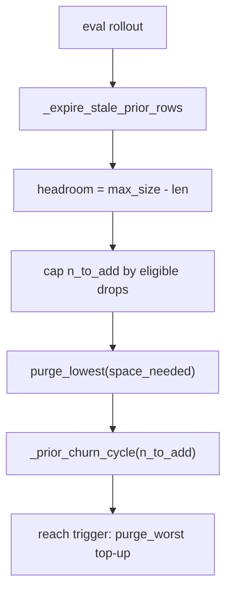

# Prior buffer

*Drift: **M** (mixed). Verified against commit `a637e70`, 2026-09-20. Sources at the end.*

The prior buffer is the store the backward branch draws its terminal states from. A backward step picks rows out of it, reads each row's latent state, and rolls a fresh stochastic backward path to that endpoint; the buffer holds terminals only and no trajectories, so two draws of the same row are two different trajectories to the same point (`train.py::Modeller.draw_bwd_sample`, under `bwd_sampling_mode` `prior`). Left out and named: the shape of the noise a row is born with ([prior-buffer-row-geometry](prior-buffer-row-geometry.md)), the archive the rows are sourced from ([anchor-buffer](anchor-buffer.md)), and the trajectory store the replay branch uses ([replay-buffer](replay-buffer.md)).

## Two sources

`cfg:buffers.prior_buffer.source` selects where churn intake comes from; `train.py::Modeller._prior_churn_cycle` branches on it at the top.

Under `anchors`, the canonical config's setting, the whole churn budget goes to `train.py::Modeller.top_up_prior_from_anchors`: rows are drawn from the anchor buffer priority-weighted on its `ema_loss`, with the fraction `cfg:buffers.anchor_buffer.replay_beta` of the draw taken uniformly, jittered in latent space, re-scored, and offered to the admission gate. No prior sampler is in the loop, and `prior_buffer_prior_admit_rate` reads NaN, its denominator never incremented. It is the only source on the crystal route: `config_invariants.py::crystal_prior_model_is_retired` refuses any other value, and refuses the key's absence, whose code default is `prior_model`.

Under `prior_model` the budget is drawn from the route's prior sampler through `sample_from_prior`. Only the conformer route has one: `conformer_modeller.py::ConformerModeller._has_prior_sampler` is true while its fitted InternalPrior is loaded, and `conformer_modeller.py::ConformerModeller.sample_from_prior` draws from it. The crystal route has none: the frozen prior GFN is retired, `train.py::Modeller._has_prior_sampler` returns False, and `train.py::Modeller.sample_from_prior` raises. What the draw failed to get admitted becomes a shortfall backfilled from the anchors by the same top-up call, so this source mixes sampler rows with anchor rows in a proportion set by the admission outcome rather than by a key. With no prior sampler the cycle returns before the draw and before the anchor backfill, and a warning prints once per stage.

## Admission: the energy window

Admission is per condition. `train.py::Modeller._condition_energy_floor` returns each row's condition's best known energy $E_{\min}(c)$, preferring the `condition_log_z` tracker's `best_energy` over the anchor buffer's per-condition minimum; a condition with no observations gets $+\infty$, so its first sample is always admissible. A row is admitted when

$$E < E_{\min}(c) + \text{ramp\_floor}.$$

`cfg:buffers.prior_buffer.ramp_floor` and `cfg:buffers.prior_buffer.ramp_width` are read through `train.py::Modeller._ramp_params`, which requires $0 < \text{ramp\_width} \le \text{ramp\_floor}$ and raises otherwise. The pair is a depth ramp in energy units above each condition's own minimum, $w(d) = \mathrm{clamp}((\text{ramp\_floor} - d)/\text{ramp\_width}, 0, 1)$; admission uses `ramp_floor` alone. Before either source of $E_{\min}(c)$ exists the gate falls back to the absolute bar `cfg:buffers.prior_buffer.reward_min`, applied to the log reward with any per-condition energy reference undone (`energies/molecular_crystal.py::MolecularCrystal.unreferenced_log_r`, the identity while `cfg:energy_config.energy_reference` is null).

With `cfg:buffers.prior_buffer.anchor_floor_frac` above zero the backfill is per condition rather than pooled: every condition the draw touched gets `max(shortfall_c, ceil(anchor_floor_frac * drawn_c))` rows, built to exact counts by `train.py::Modeller._stratified_anchor_draw`. A condition holding no anchors leaves its quota unfilled and prints; it is never reassigned. Where a condition's quota exceeds its shortfall, its sampler admits plus its anchor request sum above the rows drawn for it, so admits plus anchor requests over the cycle can exceed the budget. The key is read only on the `prior_model` branch: under the `anchors` source the cycle returns before it.

## Churn, and where it runs

`train.py::Modeller.manage_prior_buffer` is called from `train.py::Modeller._admit_eval_rollout`, inside evaluation rather than inside a train step, and is called regardless of the replay buffer's own `admit_from_eval` switch. It reads the eval rollout it is handed only when no prior buffer exists, constructing the buffer around that batch; on every other call no eval row enters the buffer. The call site runs only while the stage carries the `buffers_active` flag. The budget is

$$n_{\text{churn}} = \max\left(1000,\ \frac{\Delta_{\text{bwd}}}{\text{mean\_lifetime}} \cdot \text{churn\_batch\_ref}\right), \qquad n_{\text{to\_add}} = \min(\text{eval\_num\_samples},\ n_{\text{churn}}),$$

with $\Delta_{\text{bwd}}$ the backward steps since the last call (`train.py::Modeller.bwd_step_delta`). `cfg:buffers.prior_buffer.mean_lifetime` and `cfg:buffers.prior_buffer.churn_batch_ref` reach the dynamics only through their ratio, an admission rate in rows per backward step. `churn_batch_ref` is a fixed reference rather than the live batch size, so a batch-sizer growth event does not multiply turnover. During a stage whose backward branch is inactive $\Delta_{\text{bwd}}$ is zero and the budget sits on the hardcoded 1000 floor.

## Three eviction channels

**Gate staleness.** `train.py::Modeller._expire_stale_prior_rows` applies the admission test to the resident rows: $E_{\min}(c)$ ratchets down as the tracker sees better structures, so a row admitted under a looser gate stops clearing the current one. It drops rows with `excess >= ramp_floor`, capped at `cfg:buffers.prior_buffer.expire_max_frac` of the buffer per call, worst excess first, printing when the cap truncates; at or below zero the channel is off. It runs before headroom is measured, so the rows it frees are intake room for the same call.

**Loss quantile at capacity.** `headroom = max_size - len(buffer)`, and only `n_to_add > headroom` runs the eligible-drop branch: `buffer.py::CrystalBuffer.get_elig_drop_count` marks eligible the rows whose `ema_loss` is at or below the 25th percentile among rows with at least `min_visits` draws, `n_to_add` becomes `headroom + min(eligible, overflow)`, and `buffer.py::CrystalBuffer.purge_lowest` removes up to `space_needed` of them with $p \propto \mathrm{softmax}(-\text{loss})$, the realised count read back from the length delta. Both prior-buffer call sites pass `loss_floor` as $+\infty$, disarming that function's absolute-nats cut, and the purge call passes `loss_min` as $-\infty$, disarming its uncapped forced-purge branch. `min_visits` is 5 here, and `select_counts` increments only on draws, so a row never drawn is never eligible.

**Reach purge.** After the churn cycle the excess above $E_{\min}(c)$ is pooled over the buffer and its `cfg:buffers.anchor_buffer.reach_quantile` quantile compared against the margin: $\text{reach} = 1 - q/\text{ramp\_floor}$. Below `cfg:buffers.anchor_buffer.reach_threshold`, and with `cfg:buffers.anchor_buffer.reach_topup_size` positive, the top-up is called with `purge_worst=True`, which first removes up to that many rows, capped at the buffer length, ranked by excess above their own condition's minimum. A $+\infty$ floor scores $-\infty$, which places those rows last in that ranking.

## What `max_size` does

Below capacity the loss-quantile branch never runs, so `cfg:buffers.prior_buffer.max_size` sets whether a row can be evicted for its `ema_loss` at all, alongside the staleness and reach channels that read energy. Where it binds, headroom is zero, intake is limited to the eligible set, and the rows removed are those at or below the 25th `ema_loss` percentile. A full buffer whose rows have never been drawn has an empty eligible set, and `n_to_add` collapses to whatever staleness freed.

## What `y` stores

`buffer.py::CrystalBuffer` computes a scalar `y` per row from the key `train.py::Modeller._buffer_y_fn` returns, which is `cfg:energy_function` itself. On the crystal route that string is `elj` and the attribute of that name is the eLJ lattice sum multiplied by the batch's stamped `lj_coeff` (`energies/molecular_crystal.py::MolecularCrystal.stamp_lj_coeff` writes the stamp, `mxtaltools/dataset_utils/data_class_methods/crystal_analysis.py::MolCrystalAnalysis.compute_eLJ_energy` applies it), with no division by $z'$ and none of the density, pressure, reduction or Jacobian terms. The prior buffer's `y` feeds the buffer energy statistics (`train.py::Modeller._buffer_core_stats`), and the same key names the attribute the progress metrics' energy marginal reads off the sample batch against the prior dataset's `y`. It is not commensurate with $E_{\min}(c)$, the composite total reconstructed as $-\log r \cdot T$.

The staleness expiry, the reach trigger and the `purge_worst` ranking all compare a resident row against $E_{\min}(c)$, and all three read `train.py::Modeller._prior_row_energy` instead. That composes the row's current training energy live from two stored legs, $(1 - \lambda)\,\text{flow\_energy} + \lambda\,\text{physical\_energy}$, so a row admitted at one $\lambda$ is judged at today's. It returns `physical_energy` alone when the rows carry no `flow_energy`, and raises when they carry no `physical_energy`, the state of a buffer restored from before the leg split.

## Seeding and the stage actions

`cfg:buffers.prior_buffer.seed_source` chooses between `generated` (lazy creation from the first evaluation batch) and `prior_dataset`. Under the latter, `train.py::Modeller.init_prior_buffer_seed` builds the buffer at init from the prebuilt dataset loaded off `cfg:prior_path`, random-subsampled to `max_size`, conditioned to match generated candidates' key set, and constructed fresh so `ema_loss`, `select_counts` and `ema_logw` start clean. It is skipped when a checkpoint-restored buffer exists. `train.py::Modeller.grow_prior_buffer` adds up to `cfg:buffers.prior_buffer.min_size` prior-sampler rows, capped at the room left under `max_size`, ungated and tallied as `from_seed`. The init calls it only when a prior sampler exists and `cfg:buffers.prior_buffer.source` is not `anchors`; with a prior sampler under the anchors source the init skips it and prints `grow_prior_buffer SKIPPED` (the init-time fill under the anchors source was retired 2026-09-23).

Three stage actions touch the buffer, all in `protocol.py::ACTIONS`:

- `rebuild_prior_by_churn[:N]` discards the buffer and refills from zero by repeating `_prior_churn_cycle` in chunks of `min_size`, to `N` rows or to `cfg:buffers.prior_buffer.init_fraction` of `max_size`. A cycle that admits nothing ends the loop, a cap of four times the ideal cycle count plus four prints when it truncates, and the outgoing buffer is held and restored if nothing was admitted.
- `reseed_prior_from_dataset[:flush]` re-adds the prior dataset, additive and subsampled to the remaining headroom by default, or with `flush` replacing the buffer with a fresh full-size draw. Neither variant applies the admission gate; the rows count as `from_seed`.
- `seed_prior_from_anchors:N[:flush]` tiles each condition's single lowest-energy anchor `N` times with noise and adds the copies whose rescored energy is finite, with no admission gate; with `flush` that set replaces the buffer (`train.py::Modeller.seed_prior_from_condition_minima`).

## The exact-density trainer's buffer route

Under `--stored_source buffer`, both stages of `inn_modeller.py` take their rows from these two stores (stage 1 fits the prior buffer's rows, stage 2 trains on them as stored rows), built by `InnModeller.init_inn_buffers` from the pieces above rather than through `manage_prior_buffer`. The anchors are `init_anchor_buffer_seed` over the training rows alone (`prior_row_train`, in prior-row order), so a held-out prior row never enters the archive or sets $E_{\min}(c)$ through it; on this route `InnModeller.init_data_rows` folds neither the prior's rows nor the training conditions file's own crystals into the tracker's floors (`InnModeller.fold_condition_crystals` with `fold_floor` false: a training molecule's carrier is a copy of one of its prior rows, which the row split may hold out). $E_{\min}(c)$ then takes the anchors, the admitted children, and the policy's draws in training and at each eval. The start-up line compares each anchor's latent, $\log R$ and condition with the training row it came from and raises on a mismatch.

The prior buffer holds up to `--pbuf_rows_per_condition` rows per training condition, fewer for a condition with no anchor under the gate or one left out as below. `InnModeller.pbuf_top_up` asks each condition for its deficit below that count, at most a budget in all; the children are drawn from that condition's anchors already under the gate (`InnModeller.pbuf_refresh_pool`; `InnModeller._stratified_anchor_draw` draws uniformly with replacement within a condition from that pool, where `train.py`'s draws from all of the condition's anchors, without replacement while the pool allows, weighting by `ema_loss` when `cfg:buffers.anchor_buffer.replay_beta` is below 1), noised by the selected tile, scored once and admitted through `top_up_prior_from_anchors`, so the admission window above applies unchanged. A condition asked `PBUF_STARVE_MISSES` children since its last admission without one admitted leaves the quota, with a printed line, until the next refill clears the exclusion. The start-up fill and every churn's refill go through `InnModeller.pbuf_fill`: top-ups of at most `PBUF_FILL_CYCLE` children, each scored as one batch, until the deficit below the target is gone or a call admits nothing, at most four calls per `PBUF_FILL_CYCLE` of deficit plus `PBUF_REFILL_ROUNDS`. At each eval `InnModeller.pbuf_churn` runs `_expire_stale_prior_rows`, retires uniformly at random `churn_batch_ref / mean_lifetime` rows per update that stepped since the last churn, in either stage, rounded, at least one and at most the buffer's length (the rate `manage_prior_buffer` admits at, without its floor of 1,000 rows and its `cfg:eval_num_samples` ceiling; a buffer of $N$ rows turns over in about $N \cdot$ `mean_lifetime` / `churn_batch_ref` updates, expiry aside), then clears the exclusion and refills through `pbuf_fill`. With `cfg:buffers.prior_buffer.mean_lifetime` small enough that the retirement reaches the buffer's length, every eval redraws the whole cloud. A retry after an out-of-memory error retires nothing further and refills again. Nothing here reads `ema_loss` for eviction, and `max_size` is unread.

An update's rows are drawn uniformly with replacement (`InnModeller.pbuf_draw`). In stage 1 the draw takes the latents and the stored condition ids alone (`buffer.py::CrystalBuffer.sample_tensors`, no graph built; the currency check below confirms the stored ids against `condition_samples`), and stage 1 fits them by likelihood. In stage 2 their $\log R$ is recomposed from the stored energy legs at the training temperature with no energy call, and, once the update steps (`InnModeller.commit_pbuf_step`), each finite row's absolute residual enters its `ema_loss` through `buffer.py::CrystalBuffer.update_losses`, an exponential average set to the residual on a row's first visit. The eval's `eval_bwd/*` still reads the prior's training rows (`InnModeller.stored_rows`), not the buffer. `InnModeller.check_buffer_reward_currency` rebuilds 512 buffer draws (with replacement) from their latents on their conditions' molecules at start-up and raises when the two $\log R$ differ by a median of 0.05 nats or more. `InnModeller.check_buffer_options` refuses the route, before any data is read, without molecule conditions, with temperature conditioning, `--data_noise_log_range`, `--grow_stored`, `--rows_per_molecule` above 1, `--w_mle`, `--mle_noise_log_range` (stage 1 fits the buffer's rows instead) or `--pbuf_rows_per_condition` below 1, when `cfg:molecules_path` equals `cfg:prior_path`, when `cfg:buffers.anchor_buffer.seed_source` is not `prior_dataset`, and when `cfg:buffers.anchor_buffer.frozen` is false. The fill's and the checks' energy calls count in `energy/startup_calls`, the churn's in `energy/samples_total` and `energy/buffer_churn_calls`.

## A pre-noised prior

When `cfg:prior_path` is a pre-noised build (`data_processing/build_noised_prior.py`; [docs/design/prior_dataset_build.md](../design/prior_dataset_build.md)), `train.py::Modeller._load_noised_prior` reads it from its stored terms behind a stratified 512-row re-score, keeps the training split's rows of `cfg:noised_prior.train_kinds` inside `cfg:noised_prior.packing_window` and within `cfg:noised_prior.window_kT` x T of their condition's floor (`noised_prior.py::select_rows`), and sets `prior_is_prenoised`. The prior buffer is then seeded from those rows as from any prior (`init_prior_buffer_seed`) and nothing else enters or leaves it: `train.py::Modeller._prior_is_static` makes `manage_prior_buffer`, `rebuild_prior_by_churn` and `top_up_prior_from_anchors` return at once, each printing once that it was skipped, so no row is noised, admitted, churned or expired in the run. A prior that is not a pre-noised build keeps every mechanism on this page unchanged.

`train.py::Modeller._noised_prior_record`, called by `init_prior_dataset` on every prior, reads `cfg:noised_prior` through `noised_prior.py::settings`, so an unknown key in the block raises whichever kind the file is. On a file without `noised_prior.py::MANIFEST_KEY`, a present block prints once that it is inert. On a build, a manifest `temperature` other than `cfg:energy_config.temperature` prints a warning, and the load line shows the build temperature beside K and the radius range. The result records `data/prior_prenoised` and, for a build, the manifest's `k`, `log_lo`, `log_hi`, `window_kT_target` and `temperature` in the run config's `data/` block ([run-reading](run-reading.md)).

**Basin-set builds.** `build_noised_prior.py --basins` takes its anchors from a basin set (MXtalTools `crystal_search/basin_set.py::write_basin_set`; [docs/design/basin_set.md](../design/basin_set.md)) instead of a prior file: `data_processing/build_noised_prior.py::load_basin_anchors` refuses a set whose energy target is not the run's, converts its raw energies and Hessians to the run's currency (x `--thermal_scaling_factor` on eLJ), and builds one anchor per usable basin; after scoring, `::check_basin_energies` drops (and counts in the manifest's `basin_set.dropped_off_chart`) every anchor whose rescored energy misses its basin's by more than `--energy_tol`, which is what the latent clip in `::score` does to a cell outside the trainer's length box, and refuses the set past 20%. Every row carries `basin_id`, `basin_p`, `basin_hand`, `basin_H`, `basin_live` and `basin_E`; `--k 0` writes anchors only, which a run trains with `cfg:noised_prior.train_kinds` including `'anchor'`.

**Live draws in MLE.** With `cfg:noised_prior.live_kernel` set, the `dataset` branch of `draw_bwd_sample` replaces each drawn row's chart point by a fresh draw (`train.py::Modeller._live_kernel_draw`); the draws are never scored, and the stored `log R` stays the row's. `'basin'` draws in the basin's own cell parameters, x = `basin_p` + L z with L L^T = `cfg:noised_prior.live_tau` kT (`basin_H` on `basin_live`)^-1, |lambda| per mode, each mode's width capped at 1 in coordinates scaled by `cfg:noised_prior.live_caps` (`::Modeller._basin_kernel_table`), and canonicalises the crystal into the FD chart through `energies/fd_coordinates.py::FDCoordinates.from_params` (`::Modeller._basin_fresh`): a draw with no chart point is redrawn up to `cfg:noised_prior.live_redraws` times, then the row keeps its stored point and is counted. `cfg:noised_prior.live_bank` chart points per row are drawn at the first draw and a share `cfg:noised_prior.live_fresh_frac` of each batch is drawn fresh and written back (`::Modeller._basin_kernel_draw`), because the canonicalisation costs about 0.55 s per 1000 MIPCAS draws on CPU (2026-10-30). On the latent chart the draw goes through `energies/molecular_crystal.py::latent_rows_from_params`: canonicalised onto the +1 sheet, one of its trainer-box images drawn uniformly, and its unclipped latent kept only inside the live clamp. The prototype values `'hessian'` and `'iso'` instead take the Hessian of the trainer's own `-log R` at each row in the run's chart (`::Modeller._live_kernel_table`, built once by autograd at the first draw) and reflect bounded rows into [-1, 1].

Under `cfg:buffers.store.enabled` on `model.kind nf`, `draw_bwd_sample` returns `train.py::Modeller._store_draw` before any branch on this page: the backward branch draws uniformly from the row store's data rows, which are the same `prior_dataset` rows, and writes no `update_losses` priority. The prior buffer is still seeded and published under its `prior_buffer_*` keys and is not drawn ([row-store](row-store.md)).

## Telemetry

`prior_churn` is a dict of counters drained on read at each eval: `prior_buffer_added` sums the three source tallies, `prior_buffer_expired` is the staleness subset of `prior_buffer_evicted`, and `prior_buffer_anchor_fraction` and `prior_buffer_prior_admit_rate` are NaN on a zero denominator. All are flows over one window, not a resident composition; no prior-buffer row records which source admitted it.

## Owner choices

*Left for the owner. Three buckets: bullets bitten, design choices, priorities.*

## Config keys

`cfg:buffers.prior_buffer.{source, seed_source, mean_lifetime, churn_batch_ref, min_size, max_size, init_fraction, expire_max_frac, anchor_floor_frac, reward_min, ramp_floor, ramp_width, weighted_bwd_beta}`, `cfg:buffers.anchor_buffer.{replay_beta, noise_log_range, reach_quantile, reach_threshold, reach_topup_size, seed_source, frozen, tile}`, `cfg:noised_prior.{window_kT, packing_window, train_kinds, check_rows, live_kernel, live_tau, live_width_cap, live_caps, live_redraws, live_bank, live_fresh_frac}`, `cfg:energy_config.temperature`, `cfg:molecules_path`, `cfg:eval_num_samples`, `cfg:prior_path`, `cfg:energy_function`, `cfg:energy_config.energy_reference`.

Code: `train.py::Modeller.manage_prior_buffer`, `_prior_is_static`, `_load_noised_prior`, `_noised_prior_record`, `_live_kernel_draw`, `_live_kernel_table`, `_basin_kernel_table`, `_basin_fresh`, `_basin_kernel_draw`, `data_processing/build_noised_prior.py::load_basin_anchors`, `data_processing/build_noised_prior.py::check_basin_energies`, `noised_prior.py::select_rows`, `noised_prior.py::settings`, `_expire_stale_prior_rows`, `_prior_churn_cycle`, `rebuild_prior_by_churn`, `top_up_prior_from_anchors`, `_stratified_anchor_draw`, `reseed_prior_from_dataset`, `init_prior_buffer_seed`, `grow_prior_buffer`, `_prior_row_energy`, `_buffer_y_fn`, `_has_prior_sampler`, `sample_from_prior`, `_ramp_params`, `_condition_energy_floor`, `_admit_eval_rollout`, `draw_bwd_sample`; `inn_modeller.py::InnModeller.init_inn_buffers`, `.check_buffer_options`, `.check_buffer_reward_currency`, `.pbuf_refresh_pool`, `.pbuf_top_up`, `.pbuf_churn`, `.pbuf_fill`, `.bwd_sampling_mode`, `.pbuf_draw`, `.commit_pbuf_step`, `.pbuf_ref_energy`, `.pbuf_stats`, `._stratified_anchor_draw`, `.init_data_rows`, `.fold_condition_crystals`, `.stored_rows`; `buffer.py::CrystalBuffer.update_losses`, `buffer.py::CrystalBuffer.sample_tensors`; `buffer.py::CrystalBuffer.get_elig_drop_count`, `buffer.py::CrystalBuffer.purge_lowest`; `conformer_modeller.py::ConformerModeller._has_prior_sampler`, `conformer_modeller.py::ConformerModeller.sample_from_prior`; `config_invariants.py::crystal_prior_model_is_retired`; `energies/molecular_crystal.py::MolecularCrystal.unreferenced_log_r`, `energies/molecular_crystal.py::MolecularCrystal.stamp_lj_coeff`; `protocol.py::ACTIONS`.

## Could be tooling

- The churn ceiling is `cfg:eval_num_samples`, a key belonging to evaluation, and the admission rate is a ratio of `mean_lifetime` and `churn_batch_ref`. One rows-per-step key with its own ceiling would carry both.
- The resident composition is not recoverable from any emitted metric. `buffer.py::CrystalBuffer` carries a per-row `origin` column whose codes (`buffer.py::ORIGIN_NAMES`) name rollout, eval and bootstrap admissions; no prior-buffer admission path passes one, so every prior-buffer row holds the default code.
- `buffer.py::CrystalBuffer.purge_lowest` carries `loss_floor`, `loss_min` and `temperature` as absolute-nats parameters with 1.0 defaults. Its one call site, in `train.py::Modeller.manage_prior_buffer`, passes `loss_floor` as $+\infty$ and `loss_min` as $-\infty$ and leaves `temperature` at its default.

## Sources

Repo, read in the working tree: `buffer.py`, `train.py`, `protocol.py`, `energies/molecular_crystal.py`, `configs/mk_dev.yaml` `buffers.prior_buffer`, `docs/design/prior_buffer_sizing.md`, and in the sibling repository `mxtaltools/dataset_utils/data_class_methods/crystal_analysis.py`. Uncommitted there: the `unreferenced_log_r` calls in `train.py`, that method in `energies/molecular_crystal.py`, and `energy_config.energy_reference` in `configs/mk_dev.yaml`. Memory used to locate the code, not as evidence: project_prior_buffer_cap_starts_target_drift, project_prior_buffer_churn_batch_decouple, project_prior_buffer_scores_raw_elj, project_prior_buffer_full_churn_stall, project_rebuild_prior_by_churn, project_reseed_prior_flush, feedback_prior_buffer_anchors_only_default, project_prior_model_sampling_only. Two no longer match the code. project_prior_buffer_scores_raw_elj has the staleness, reach and `purge_worst` channels reading `y` and has `y` without the `lj_coeff` factor; the three channels read `train.py::Modeller._prior_row_energy` and `y` carries the factor. The design note's section 7 writes the staleness test on `y` and the per-condition anchor quota as `ceil(anchor_floor_frac * budget / N_c)`; the code tests `_prior_row_energy` and computes the quota as `ceil(anchor_floor_frac * drawn_c)` over the conditions the draw touched.
