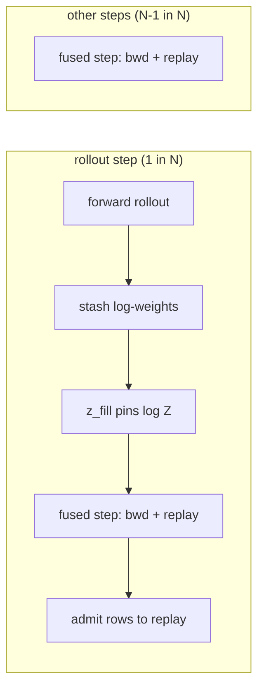

# Rollout cadence and dose

*Drift: **M** (mixed). Verified against commit `78de930`, 2026-10-04. Sources at the end.*

With `cfg:replay_loss_coeffs.resample_last_k` at 0, the forward branch is the only branch of a training step that calls the energy function. The backward and replay branches train on rows whose energies were stored when the rows were made, and the prior buffer's churn runs inside evaluation, not inside the step. A positive `resample_last_k` re-scores a re-sampled terminal with one energy call per replay step, and a positive `cfg:replay_loss_coeffs.stored_force_k` re-scores the reward on the admitted rows at every admission, in chunks of `cfg:replay_loss_coeffs.force_chunk_rows` rows (`train.py::Modeller._admission_force_legs`). So the number of steps between forward rollouts is the energy-cost axis of training, and on a machine-learned potential the energy call is most of the step. This page is about what a forward rollout buys, what it costs to do fewer of them, and which quantity governs the harm.

The key is `cfg:stage.fwd_rollout_every`, written $N$ below. At $N > 0$ the forward branch rolls out on one fused step in $N$, counted from the stage's first fused step; the anchor is held in memory, so a resumed leg rolls out on its first step and counts from there. At $N = 0$ there is no cadence: the forward branch runs on every step where its share is at or above `cfg:stage.deactivate_threshold` (`cfg:controller.deactivate_threshold` where the stage declares none), and on the `cfg:controller.refresh_every` force-refresh steps unless nothing in the stage reads the branch's rolling statistics (`protocol.py::Stage.read_modes`). Under a cadence the force-refresh does not run the forward branch (`train.py::Modeller._fwd_gates`).

## What a rollout buys

On a cadenced stage that declares no sidecar (next paragraph) and whose forward share sits below the deactivate threshold (the `equilibration` stage of the canonical config pins it at 0), the forward loss is detached and enters the fused loss at weight 0. The rollout's live rows enter the loss in one other place, the cross-branch pooled term, and only with `cfg:fwd_loss_coeffs.pooled_vg` above 0 and `cfg:fwd_loss_coeffs.pooled_source` at `fwd`; the canonical base block carries `pooled_vg` 0. Its trajectories reach the gradient through the replay buffer from the next step on, since admission lands at the end of the rollout step, after that step's replay draw; the rollout step itself trains only the backward and replay branches. Such a rollout buys two things: a batch of fresh rows admitted to the replay buffer, and an on-policy reading of log Z.

A stage that declares `cfg:stage.fwd_z_sidecar` adds the forward loss to the fused loss at weight 1, outside the share-weighted mix, on every rollout that is not a z-pin (`train.py::Modeller.fused_train_step`). `protocol.py::Stage` requires `freeze_policy` and `emp_z` on that stage's forward block, so the term reaches the log Z head and not the policy. The `var_conditioning` stage of the canonical config runs this way.

The rollout rate is therefore an *admission* rate, and the on-policy reading is what pins log Z. The two products are treated separately below.

## The buffer side: Little's law

With $B$ rows admitted per rollout (`cfg:buffers.replay_buffer.churn_rate` at 0 sets the admission budget of each manage call to the live batch size, which is the whole rollout at forward `repeats` 1), rollouts as the only admissions, and a full replay batch drawn every step, the buffer obeys the queueing identities. Let $B$ be the batch size and $\tau$ the mean residence in steps (`cfg:buffers.replay_buffer.mean_residence_steps`). The eval rollout (under `cfg:buffers.replay_buffer.admit_from_eval`) and the stage-entry Z bootstrap rollout (`train.py::Modeller.bootstrap_z_by_rollout`) pass through the same manage call and add to the admission rate below. The manage call that creates the buffer admits up to `max_size` rows of its batch and not the per-call budget.

$$
\text{admissions per step} = \frac{B}{N}, \qquad
\text{occupancy } O = \frac{B\,\tau}{N}, \qquad
\text{draws per row} = \frac{\tau B}{O} = N .
$$

Two things fall out. Reuse per row equals $N$ and nothing else: $\tau$ and $B$ cancel. And because the eviction hazard is memoryless, the age distribution of resident rows is exponential with mean $\tau$ whatever the arrival pattern, so mean age equals $\tau$ and nothing else. In the code the hazard evicts a uniformly drawn fraction $\text{elapsed}/\tau$ of the resident rows at each manage call, with elapsed the steps since the previous call, so $\tau$ is in steps at any $N$; a hard age cap at `backstop_mult` times $\tau$ and a uniform displacement of resident rows when `max_size` binds sit on top of the hazard (`train.py::Modeller.manage_replay_buffer`). The two knobs are independent levers on two different failures:

| failure | what drives it | row property | knob | metric |
|---|---|---|---|---|
| staleness: the row no longer represents the policy | how far the policy moved since the row was born | age | $\tau$ | `replay/policy_drift_ess_frac` |
| overfit: the policy fits these exact rows | how often the row was trained on | draws | $N$ | `replay/val_gap_nats` |

Staleness happens whether or not a row is ever drawn; overfit happens only through drawing. What *is* welded is overfit and cost, because both are $N$. Buying energy savings buys reuse, and there is no way to give the reuse back short of drawing less than a full batch per step, which cuts across the loss weights being weights rather than sample fractions ([loss-composition](loss-composition.md)).

The draw also needs something to draw from: $O \ge B$, which is $\tau \ge N$. Occupancy is a consequence of the two knobs, never a lever. The age distribution reaches its stationary exponential shape only after several multiples of $\tau$ steps, so a reading taken earlier is a transient.

Staleness is a relevance problem, not a correctness one. A stored trajectory re-scored under the current policy gives an unbiased trajectory-balance residual, because TB is off-policy correct: at each draw the forward and backward terms are re-scored on the stored states (`models/gfn.py::GFN.get_traj_replay`) and the reward is recomposed from the row's stored energy terms. A stale row trains the policy in a region it no longer visits; it does not bias the gradient.

## The Z side: what must hold when rollouts are rare

Between rollouts nothing on-policy is measured, so log Z is frozen. In the code the training step leaves the level alone between rollouts where the backward and replay blocks carry `freeze_z` (`cfg:bwd_loss_coeffs.freeze_z` and `cfg:replay_loss_coeffs.freeze_z` are 1 in the canonical config), and the eval rollout moves it through the same fill under `cfg:z_calibration.fill_from_eval` at `fill`, which the canonical config carries (`train.py::Modeller._eval_z_fill`). Under rare rollouts the dangerous lag has a definite sign: *low*. The policy absorbs the level onto the stored and anchor rows, and at the next rollout the closed-form root walks down to meet the stale Z. That loop is the identifiability failure discussed on [trajectory-balance](trajectory-balance.md), and the only brake is to snap Z to the fresh batch at every rollout. The full-batch root's standard error is $\text{rms}_{\text{clipped}}/(\sqrt{B}\cdot f_{\text{unclipped}})$ ([batch-size](batch-size.md)).

Two invariants follow. docs/design/rarer_rollouts.md states them as one invariant that a config must not be able to forge. The code raises on the first at load and reports the second.

- The Z-calibration servo must be off on the stage (`cfg:stage.flags.z_calibration` false). Its rollout mode does its own forward rollout and energy call per Z step, off a sensor that is frozen between rollouts, so it would fire on every *skipped* step and restore the cost the cadence removed. `protocol.py::Stage` raises on the pairing at load.
- The level fill must be armed (`cfg:z_calibration.fill_threshold` above 0). It is then the only thing pinning log Z at a rollout. This is an error-level rule of `config_invariants.py::fwd_rollout_cadence_is_well_formed`: the trainer prints it at load without raising (`utils.py::_report_config_invariants`), and the config contract check fails on it (`config_snapshot.py::contract`). With the threshold at 0 `train.py::Modeller.z_level_fill` returns without acting. A stage that declares `cfg:stage.fwd_z_sidecar` is exempt from the rule: there the forward `emp_z` term pins the head on each rollout, and the fill stashes nothing for a head that is not a single scalar (`train.py::Modeller._z_fill_head_is_fillable`). Under `fill_mode: absorb`, which the canonical config carries (the code default is `snap`), the threshold is only the enable switch; the fill is a one-dimensional Kalman filter whose gain is the batch's precision share.

The fill runs inside the rollout step, after the stash and before the backward and replay losses are built, so those residuals are computed against the pinned level and no optimizer step on Z is spent against the stale one. The one exception is a step whose forward loss is live (an active forward share, or the sidecar), where log Z is already in the forward graph and the fill runs after the step instead (`train.py::Modeller.fused_train_step`).

An extra rollout whose only product is the Z stash, with no admissions and no gradient, is available as `cfg:stage.z_pin_rollout_every`, which sets the pin frequency independently of the admission rate. It fires on steps the cadence skipped, on its own period from the same anchor, and `protocol.py::Stage` refuses a value that is not strictly below $N$.

## The state variable is a dose

Define the dimensionless dose

$$
D = N \cdot \frac{\text{lr}}{10^{-4}} \cdot \frac{w_{\text{replay}}}{0.1} \cdot \frac{1000}{B} .
$$

Occupancy, cap, residence and mean age cancel in $D$. The branch losses are normalised means, so the per-step parameter displacement a single resident row contributes scales as $\text{lr}\cdot w_{\text{replay}}/B$, and a row is drawn $N$ times over its residence; the product is $D$, with $\tau$ and $O$ dropping out of both the reuse count and the per-row weight. What does not appear in $D$ is the temporal density of those draws: the same total exposure delivered over a short residence and a long one differ, and $\tau$ re-enters there.

The memorisation sensor `replay/val_gap_nats` is the median absolute TB residual over held-out replay rows minus the median over the step's trained replay rows (weighted by the draw's importance weights where it has them), both scored at the same parameters and the same log Z (`train.py::Modeller._replay_val_stats`). The two sides are logged as `replay/val_resid_med` and `replay/train_resid_med`. The measurement is taken on replay steps whose step index is a multiple of ten, only with `cfg:buffers.replay_buffer.val_frac` above 0 and at least `cfg:buffers.replay_buffer.val_min` held-out rows resident; the logged value, which the `val_gap_max` bar reads, is the metric tracker's running average of it (`train.py::Modeller.replay_train_step`).

## Cost

With `cfg:replay_loss_coeffs.resample_last_k` at 0 only the forward branch calls the potential inside a step, so a step without a rollout makes no energy call. On the local ELJ route the speed-up saturates by about $N = 20$ because the backward and replay branches set a floor on step time. On a machine-learned potential the forward call is most of the step, so the saving keeps growing with $N$ ([mlip-energy-routes](mlip-energy-routes.md)).

## Triggers, and how to read the cadence

`cfg:stage.fwd_rollout_every` is the fixed period. A fused step off the period still rolls out in three cases, tested in this order (`train.py::Modeller._fwd_gates`): while the replay buffer holds fewer trainable rows than `cfg:stage.replay_warmup_rows`, a warm-up that latches off for the rest of the stage on the first step the count is met; when a bar under `cfg:stage.fwd_rollout_triggers` fires; and on a z-pin step. The bars are read by `train.py::Modeller._rollout_trigger_fires`. Four exist: `occupancy_min_batches` fires below a buffer-to-batch ratio, `val_gap_max` above a validation gap, `drift_std_max` above a policy drift, `ess_min` below a drift ESS. A bar at zero is off, a reading that does not exist yet never fires, and no bar fires on the step right after a period, warm-up or trigger rollout. Each fire prints the bars that tripped and is counted under `rollout/trigger_<bar>`; warm-up rollouts are counted under `rollout/warmup` and z-pins under `rollout/n_z_pin`. A positive bar on a stage with $N = 0$ is refused at load (`protocol.py::Stage`). Under the row store (`cfg:buffers.store.enabled`, [row-store](row-store.md)) the occupancy reading is `train.py::Modeller._replay_rows`, the store's drawable row count, which the seed rows alone hold at or above $n_{\text{mle}}/B$; `val_gap_max`, `drift_std_max` and `ess_min` read replay-buffer statistics the store does not write, and a positive value of any of them is refused beside it (`config_invariants.py::row_store_is_well_formed`), as is `cfg:stage.replay_warmup_rows`.

Two mechanical facts about the occupancy bar. It reads the buffer against the *live* batch size, and the admission budget follows the live batch as well: `churn_rate` 0 admits the live batch size per manage call, and a positive `churn_rate` is scaled by the ratio of the live batch to `cfg:batch_size` (`train.py::Modeller.manage_replay_buffer`). And a buffer whose equilibrium occupancy sits near the bar does not fall through it; it equilibrates on it, and the bar then sets the cadence rather than $N$.

`rollout/every_eff` and `rollout/rate` are reciprocals of one cumulative figure, published on every ten-step report: the steps since the stage's first counted rollout over the rollouts counted since, that first one included (`train.py::Modeller.ten_step_reporting`). On a fixed period with no extra rollouts `rollout/every_eff` therefore reads $s/(\lfloor s/N \rfloor + 1)$ after $s$ steps, a sawtooth that stays below $N$ and closes on it as the stage runs. `rollout/n` is an integer count per ten-step window, so its median is quantised; its sum over a known span is the rollout count on that span. The same report logs `train_step_time` as the mean over the batch sizer's window of recent step times, beside `train_step_time_rollout` and `train_step_time_replay`, the medians over that window's rollout steps and its other steps. A step counts as a rollout step there when the period, the warm-up or a trigger rolled it out; a z-pin step falls with the others.

## Calibrations

- **[calibration, rr07_rr_n7_v1, 2026-09-07]** Little's law on a real run at $B = 400$, $N = 7$, $\tau = 35$: predicted occupancy 2000, observed 2024 to 2381; predicted reuse 7, observed 7.53.
- **[calibration, local ELJ, batch 400, 2026-09-07]** Step time $t(N) = 0.26 + 0.51/N$ seconds.
- **[calibration, rr and hc batteries, 2026-09-08]** Fitted absorption rate $\lambda \approx 0.0195\,D^{0.75}$, $R^2 = 0.94$, across the arms that define $D$ above.
- **[calibration, rr and hc batteries, ELJ route, 2026-09-08]** Arms matched on $D$ at reuse differing two-fold absorbed at the same rate.

## Owner choices

*Left for the owner. Three buckets: bullets bitten, design choices, priorities.*

## Config keys

`cfg:stage.fwd_rollout_every`, `cfg:stage.z_pin_rollout_every`, `cfg:stage.fwd_rollout_triggers.{occupancy_min_batches, val_gap_max, drift_std_max, ess_min}`, `cfg:stage.fwd_z_sidecar`, `cfg:stage.replay_warmup_rows`, `cfg:stage.deactivate_threshold`, `cfg:stage.flags.z_calibration`, `cfg:z_calibration.{fill_mode, fill_threshold, fill_se, fill_cooldown_steps, fill_from_eval}`, `cfg:buffers.replay_buffer.{churn_rate, mean_residence_steps, max_size, backstop_mult, admit_from_eval, val_frac, val_min}`, `cfg:replay_loss_coeffs.{resample_last_k, stored_force_k, force_chunk_rows, freeze_z}`, `cfg:bwd_loss_coeffs.freeze_z`, `cfg:fwd_loss_coeffs.{pooled_vg, pooled_source}`, `cfg:controller.{refresh_every, deactivate_threshold}`, `cfg:batch_size`.

Code: `protocol.py::Stage` (parse; the servo, z-pin, trigger and sidecar refusals), `config_invariants.py::fwd_rollout_cadence_is_well_formed` (the fill rule and its sidecar waiver), `train.py::Modeller._fwd_gates`, `train.py::Modeller._rollout_trigger_fires`, `train.py::Modeller.manage_replay_buffer` (per-step hazard, admission budget), `train.py::Modeller.z_level_fill`, `train.py::Modeller.fused_train_step`, `train.py::Modeller.ten_step_reporting` (the `rollout/` and step-time keys).

## Sources

Repo: docs/design/rarer_rollouts.md, docs/design/replay_occupancy_and_cadence.md, docs/design/z_fill_process_variance.md, and the code above at the stamped commit. Memory: project_rollout_rate_is_an_admission_rate, project_rarer_rollouts_redesign, project_rollout_every_eff_wrong_at_n20, project_occupancy_bar_unreachable_churn_vs_live_batch, project_logz_lag_sign_and_cadence.
